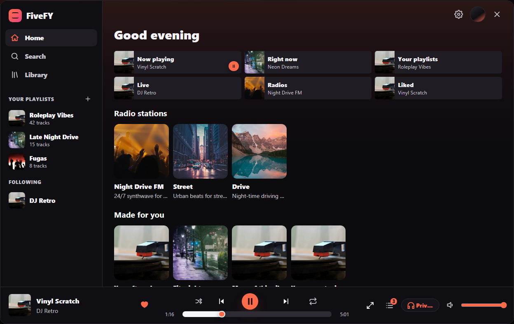
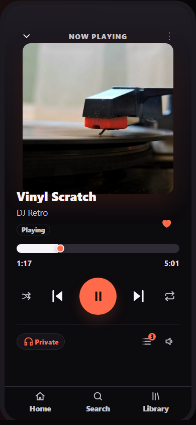

<p align="center">
  
</p>

<h1 align="center">FiveFY</h1>

<p align="center">
  A free, open source music player for FiveM: an lb-phone app, a desktop-style panel, playlists, profiles and spatial audio through speakers and vehicles.
</p>

<p align="center">
  <a href="https://OWNER.github.io/fivefy/preview.html">Live demo</a> ·
  <a href="https://github.com/OWNER/fivefy/releases/latest">Download</a> ·
  <a href="README.pt-BR.md">Português</a>
</p>

<p align="center">
  
  
</p>

---

## Features

- **Two ways to listen**: an app inside [lb-phone](https://lbscripts.com/) and a larger panel opened with `/fivefy` or a key binding. lb-phone is optional, so servers without it can use the panel only.
- **Search and play** YouTube tracks through the official YouTube Data API (or HTML scraping as a fallback), plus your own radio streams.
- **Library**: favorites, history, playlists with covers, public/private visibility and share codes to copy a playlist.
- **Social**: profiles with avatar and bio, followers, public playlists and "listening now" from people you follow.
- **Discovery**: recommendations from history, time of day and artists; most played, most skipped and server-wide favorites.
- **Spatial audio**: play through a portable speaker or your vehicle, and nearby players hear it fading with distance. Party buses and speaker trailers get a bigger range, and a hitched speaker trailer takes over as the source.
- **Shared sessions**: join what another player is playing at the same position.
- **Frameworks**: Qbox, QBCore, ESX, vRP and standalone, detected automatically.
- **Languages**: English and Brazilian Portuguese.

## Requirements

- [oxmysql](https://github.com/overextended/oxmysql) with MySQL 8 or MariaDB 10.x
- One of: Qbox, QBCore, ESX, vRP, or none (standalone uses the Rockstar license)
- Optional: lb-phone for the phone app and Fivemanage for image re-uploads

## Installation

1. Download `fivefy.zip` from the [latest release](https://github.com/OWNER/fivefy/releases/latest) and extract it into your resources folder as `fivefy`. The repository source does not include the built UI: use the release, or build it yourself (see [Development](#development)).
2. Add it to `server.cfg` after its dependencies:

   ```cfg
   ensure oxmysql
   ensure qbx_core      # or qb-core, es_extended, vrp
   ensure lb-phone      # optional
   ensure fivefy

   # Recommended: official YouTube search (https://console.cloud.google.com/apis/library/youtube.googleapis.com)
   set fivefy_youtube_key "YOUR_KEY"
   ```

3. Start the server. FiveFY creates its database tables on first start.

> Start FiveFY **after** your framework. With `Config.Framework = "auto"`, a framework that starts later still replaces standalone, but anyone who used FiveFY in between is saved under their Rockstar license.

## Configuration

Everything lives in [`config.lua`](config.lua), with comments. The main settings:

| Setting | What it does |
| --- | --- |
| `Config.Locale` | `"en"` or `"pt-BR"`. |
| `Config.Framework` | `"auto"` or a specific adapter. |
| `Config.RequirePermission` / `Config.Permission` | Restrict the app to a framework permission or ACE. |
| `Config.Phone` | lb-phone app name, identifier and whether to stop music when the phone item is lost. |
| `Config.Panel` | Command, default key and a `CanOpen` hook (e.g. block while handcuffed). |
| `Config.Search` | Provider (`auto`, `youtube_api`, `scrape`), limits and cache. |
| `Config.Stations` | Your radio streams. |
| `Config.Prop` | Speaker model (base-game `prop_boombox_01` by default) and attachment. |
| `Config.Range` | Speaker and vehicle ranges, per vehicle class and for sound-system vehicles. |
| `Config.MasterVolume` | Integration with an external volume mixer. |

Secrets are server convars, never in `config.lua`:

| Convar | Purpose |
| --- | --- |
| `fivefy_youtube_key` | YouTube Data API v3 key. Without it, search falls back to scraping. |
| `fivefy_fivemanage_key` | Fivemanage key to re-upload images from temporary hosts (e.g. Discord). If empty, lb-phone's Image key is used when `Config.Media.UseLbPhoneApiKey` is on. |

## Exports

```lua
-- Client: set FiveFY's master volume (0-100), e.g. from a volume mixer.
exports.fivefy:SetMasterVolume(80)
```

## FAQ

**Is this affiliated with Spotify or YouTube?** No. FiveFY is an independent project. Playback uses the YouTube IFrame Player API, and the YouTube Data API is used under your own key and its terms. Scraping is a fallback that can break at any time; prefer the API key.

**Where is the data stored?** In your database, in `fivefy_*` tables. Players are identified by their framework identifier (citizenid, ESX identifier, vRP user id or Rockstar license), mapped to an internal id that is the only one sent to other players.

**Coming from `mzm_CaliFY`?** See [docs/migrating-from-calify.md](docs/migrating-from-calify.md).

## Development

```sh
cd ui
npm ci
npm run dev        # browser preview with sample data at http://127.0.0.1:3002/preview.html
npm run check      # typecheck, tests and build (outputs ui/dist)
cd ..
lua tests/lua/run.lua   # Lua tests, from the repository root (Lua 5.4)
```

- [docs/api-contract.md](docs/api-contract.md): NUI actions, server actions and events.
- [docs/testing-in-game.md](docs/testing-in-game.md): what to check in game before a release.
- [CONTRIBUTING.md](CONTRIBUTING.md): how to contribute.

## License

[MIT](LICENSE). Free to use, modify and redistribute, including on paid servers. Selling it as-is is allowed by the license, but please don't: it is free.
