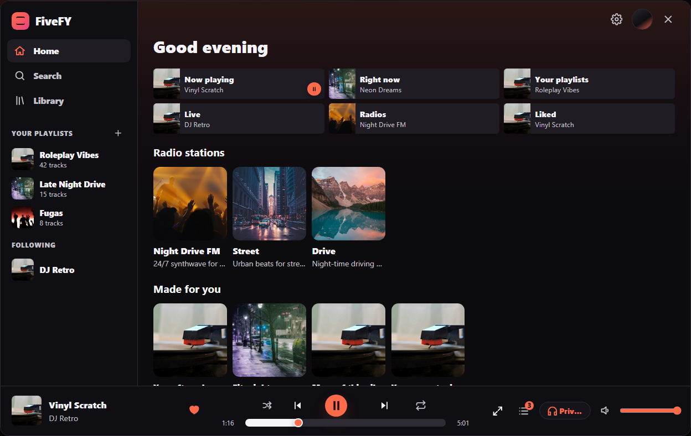
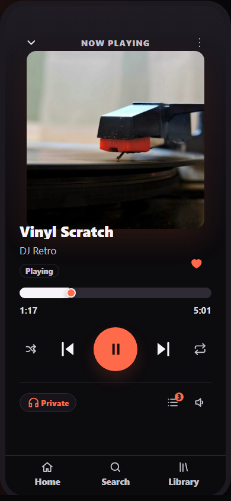

<p align="center">
  
</p>

<h1 align="center">FiveFY</h1>

<p align="center">
  Player de música gratuito e open source para FiveM: app para o lb-phone, painel no estilo desktop, playlists, perfis e áudio espacial em caixas de som e veículos.
</p>

<p align="center">
  <a href="https://OWNER.github.io/fivefy/preview.html?lang=pt-BR">Demo ao vivo</a> ·
  <a href="https://github.com/OWNER/fivefy/releases/latest">Download</a> ·
  <a href="README.md">English</a>
</p>

<p align="center">
  
  
</p>

---

## Recursos

- **Duas formas de ouvir**: um app dentro do [lb-phone](https://lbscripts.com/) e um painel maior, aberto com `/fivefy` ou por uma tecla configurável. O lb-phone é opcional: servidores sem ele podem usar só o painel.
- **Busca e reprodução** de músicas do YouTube pela API oficial (YouTube Data API) ou por scraping como alternativa, além das suas próprias rádios.
- **Biblioteca**: favoritas, histórico, playlists com capa, visibilidade pública ou privada e códigos para copiar playlists.
- **Social**: perfis com avatar e bio, seguidores, playlists públicas e "ouvindo agora" de quem você segue.
- **Descoberta**: recomendações por histórico, horário e artista; mais tocadas, mais puladas e favoritas do servidor.
- **Áudio espacial**: toque numa caixa de som portátil ou no veículo, e os jogadores por perto escutam com o volume caindo conforme a distância. Ônibus de festa e carretas de som têm alcance maior, e uma carreta de som engatada passa a ser a origem do áudio.
- **Sessões compartilhadas**: entre no que outro jogador está tocando, na mesma posição da música.
- **Frameworks**: Qbox, QBCore, ESX, vRP e standalone, com detecção automática.
- **Idiomas**: inglês e português do Brasil.

## Requisitos

- [oxmysql](https://github.com/overextended/oxmysql) com MySQL 8 ou MariaDB 10.x
- Um destes: Qbox, QBCore, ESX, vRP ou nenhum (o modo standalone usa a license da Rockstar)
- Opcionais: lb-phone para o app do celular e Fivemanage para reenviar imagens

## Instalação

1. Baixe o `fivefy.zip` da [última release](https://github.com/OWNER/fivefy/releases/latest) e extraia na pasta de resources como `fivefy`. O código-fonte do repositório não inclui a UI compilada: use a release ou gere o build (veja [Desenvolvimento](#desenvolvimento)).
2. Adicione ao `server.cfg`, depois das dependências:

   ```cfg
   ensure oxmysql
   ensure qbx_core      # ou qb-core, es_extended, vrp
   ensure lb-phone      # opcional
   ensure fivefy

   # Recomendado: busca oficial do YouTube (https://console.cloud.google.com/apis/library/youtube.googleapis.com)
   set fivefy_youtube_key "SUA_CHAVE"

   # Para a interface em português
   # (em config.lua) Config.Locale = "pt-BR"
   ```

3. Inicie o servidor. O FiveFY cria as tabelas do banco na primeira inicialização.

> Inicie o FiveFY **depois** do framework. Com `Config.Framework = "auto"`, um framework que suba depois ainda substitui o modo standalone, mas quem usar o FiveFY nesse intervalo fica salvo pela license da Rockstar.

## Configuração

Tudo fica no [`config.lua`](config.lua), com comentários. As principais opções:

| Opção | Função |
| --- | --- |
| `Config.Locale` | `"en"` ou `"pt-BR"`. |
| `Config.Framework` | `"auto"` ou um adaptador específico. |
| `Config.RequirePermission` / `Config.Permission` | Restringe o app a uma permissão do framework ou ACE. |
| `Config.Phone` | Nome e identificador do app no lb-phone e se a música para quando o jogador perde o celular. |
| `Config.Panel` | Comando, tecla padrão e um hook `CanOpen` (por exemplo, bloquear quando algemado). |
| `Config.Search` | Provider (`auto`, `youtube_api`, `scrape`), limites e cache. |
| `Config.Stations` | Suas rádios. |
| `Config.Prop` | Modelo da caixa de som (`prop_boombox_01`, do jogo base, por padrão) e posição na mão. |
| `Config.Range` | Alcance da caixa de som e dos veículos, por classe e para veículos de som. |
| `Config.MasterVolume` | Integração com um mixer de volume externo. |

Chaves e segredos são convars do servidor, nunca ficam no `config.lua`:

| Convar | Uso |
| --- | --- |
| `fivefy_youtube_key` | Chave da YouTube Data API v3. Sem ela, a busca usa scraping. |
| `fivefy_fivemanage_key` | Chave do Fivemanage para reenviar imagens de hosts temporários (como o Discord). Se ficar vazia, usa a chave de imagens do lb-phone quando `Config.Media.UseLbPhoneApiKey` estiver ativo. |

## Exports

```lua
-- Client: define o volume geral do FiveFY (0-100), por exemplo a partir de um mixer de volume.
exports.fivefy:SetMasterVolume(80)
```

## Perguntas frequentes

**O projeto tem ligação com o Spotify ou o YouTube?** Não. O FiveFY é independente. A reprodução usa a YouTube IFrame Player API, e a YouTube Data API é usada com a sua chave, sujeita aos termos do YouTube. O scraping é uma alternativa que pode parar de funcionar a qualquer momento; prefira a chave da API.

**Onde os dados ficam salvos?** No seu banco, nas tabelas `fivefy_*`. Os jogadores são identificados pelo identificador do framework (citizenid, identifier do ESX, user id do vRP ou license da Rockstar), mapeado para um id interno, que é o único enviado a outros jogadores.

**Vindo do `mzm_CaliFY`?** Veja [docs/migrating-from-calify.md](docs/migrating-from-calify.md).

## Desenvolvimento

```sh
cd ui
npm ci
npm run dev        # preview no navegador com dados de exemplo em http://127.0.0.1:3002/preview.html
npm run check      # typecheck, testes e build (gera ui/dist)
cd ..
lua tests/lua/run.lua   # testes Lua, a partir da raiz do repositório (Lua 5.4)
```

- [docs/api-contract.md](docs/api-contract.md): ações da NUI, ações do servidor e eventos.
- [docs/testing-in-game.md](docs/testing-in-game.md): o que conferir no jogo antes de uma release.
- [CONTRIBUTING.md](CONTRIBUTING.md): como contribuir.

## Licença

[MIT](LICENSE). Livre para usar, modificar e redistribuir, inclusive em servidores pagos. A licença permite vender o resource como está, mas, por favor, não faça isso: ele é gratuito.
